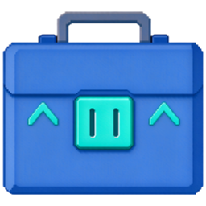
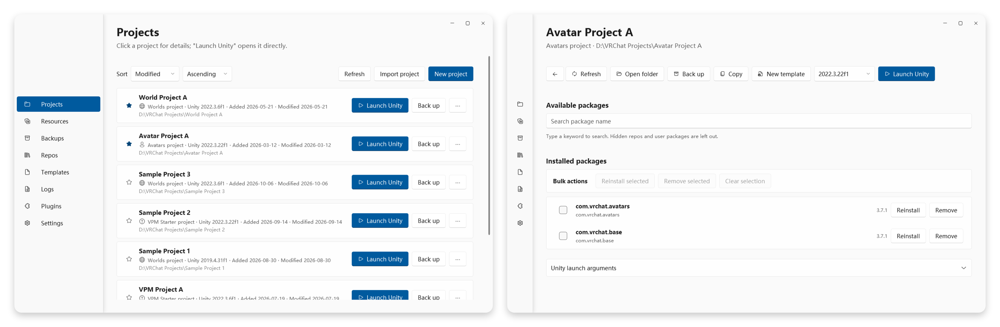

<div align="center">
  
  <h1>VRCLearn Launcher</h1>
  <p>.NET 10 と WPF で開発された、Windows 向けの VRChat パッケージ・プロジェクト管理ツールです。</p>

  [ダウンロード](https://github.com/VRLearn-Official/VRCLearn_Launcher/releases) · [简体中文](README.md) · [English](README.en.md) · [不具合報告](https://github.com/VRLearn-Official/VRCLearn_Launcher/issues)
</div>

<p align="center">
  <a href="https://github.com/VRLearn-Official/VRCLearn_Launcher/actions/workflows/build.yml"></a>
  <a href="https://github.com/VRLearn-Official/VRCLearn_Launcher/releases"></a>
  
  <a href="LICENSE"></a>
</p>

VRCLearn Launcher では、VPM リポジトリ、パッケージ、Unity プロジェクトをまとめて管理できます。C# と WPF で開発された独立したアプリケーションで、VRChat Inc. および Unity Technologies との提携はありません。

> [!WARNING]
> すでに多数のプロジェクトを管理している場合は、本ツールへの移行をおすすめしません。公式の VCC や ALCOM など、現在お使いのツールを引き続きご利用ください。

## スクリーンショット

<p align="center">
  
</p>

## 主な機能

- **リポジトリ** — VPM リポジトリの追加・管理、パッケージの検索・インストール・更新、依存関係の解決
- **プロジェクト** — 一覧表示、新規作成、お気に入り、アーカイブ。指定したバージョンの Unity で起動。バックアップ、復元、エクスポート
- **リソース** — ローカルの `.unitypackage` ファイルを管理。サムネイル、タグ、検索、説明書に対応
- **ランチャーのバックアップ** — 設定のみ、またはデータを含む全体のバックアップを作成し、指定したフォルダーに復元
- **テンプレート** — `.vrclearn-template` 形式のプロジェクトテンプレートをインポート・作成
- **プラグイン** — ローカルファイルの選択やドラッグ＆ドロップで `.vclplugin` 形式の拡張をインストール。プラグインはコミュニティが提供し、本体には同梱されません（[プラグイン開発ガイド](docs/plugins.md)）
- **Windows との連携** — `vcc://` のディープリンクとファイルの関連付け
- **更新確認** — 起動時に 1 日 1 回を上限として GitHub の最新リリースを確認。新しいバージョンがある場合はダウンロードページを案内
- **表示言語** — 簡体字中国語、英語、日本語。カスタム言語パックにも対応

## インストール

[GitHub Releases](https://github.com/VRLearn-Official/VRCLearn_Launcher/releases) から `VRCLearnLauncher-<バージョン>-win-x64-Setup.exe` をダウンロードして実行します。

- Windows 10 以降（x64）
- .NET 10 デスクトップランタイムはインストーラーに含まれます。

インストーラーにはコード署名がないため、初回実行時に Windows SmartScreen の警告が表示される場合があります。「詳細情報」を選択してから「実行」を押してください。

## ビルド

必要な環境

- Windows 10 以降（x64）
- [.NET 10 SDK](https://dotnet.microsoft.com/download/dotnet/10.0)

依存関係を復元し、アプリケーションをビルドします。

```powershell
dotnet restore src/VRCLearn.App/VRCLearn.App.csproj
dotnet build src/VRCLearn.App/VRCLearn.App.csproj -c Release
```

ソースから起動する場合は次のコマンドを実行します。

```powershell
dotnet run --project src/VRCLearn.App/VRCLearn.App.csproj
```

配布ビルドは `net10.0-windows` / `win-x64` を対象とする自己完結型です。

GitHub Actions は `main` へのプッシュ、`v*` タグのプッシュ、または手動実行でインストーラーをビルドし、成果物としてアップロードします。`v*` タグのプッシュ時には GitHub Release の下書きも作成し、インストーラーと SHA256 チェックサムファイルを添付します。

## プロジェクト構成

| パス | 内容 |
| --- | --- |
| `src/VRCLearn.App` | WPF の画面、ビューモデル、ローカライズ、テーマ |
| `src/VRCLearn.Core` | プラットフォームに依存しない処理。基本クラスライブラリ（BCL）のみ使用 |
| `src/VRCLearn.Infrastructure` | Windows API、ファイルシステム、HTTP、データ保存 |
| `src/VRCLearn.Plugin.Sdk` | プラグイン用インターフェース。プラグインが参照する唯一のアセンブリ |
| `plugin-template` | コピーして使えるプラグイン用のプロジェクトテンプレート |

依存関係は `App` → `Infrastructure` → `Core` の順です。プラグインは `VRCLearn.Plugin.Sdk` のみを参照します。パッケージ化の方法は [プラグイン開発ガイド](docs/plugins.md) を参照してください。

## データフォルダー

データは `%LocalAppData%\VRCLearnLauncher` に保存されます。設定は `config\`、データは `data\`、ログは `logs\` にあります。初回起動時に旧バージョンの設定を自動で移行します。

## ライセンス

[MIT ライセンス](LICENSE)。サードパーティーのコンポーネントとライセンスは [THIRD-PARTY-NOTICES.txt](THIRD-PARTY-NOTICES.txt) を参照してください。
