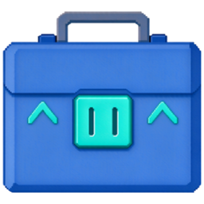
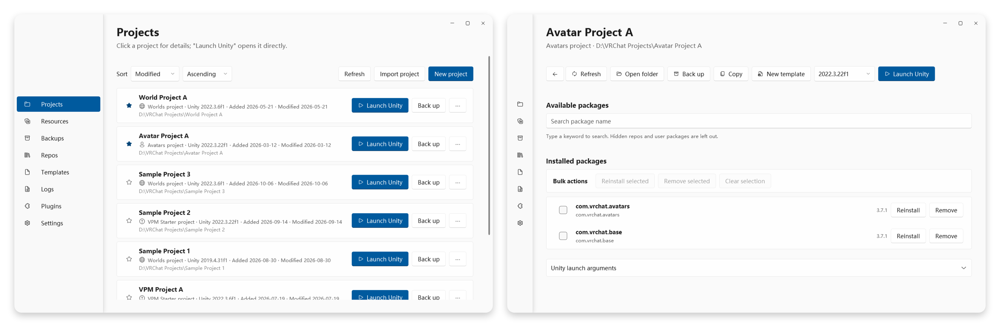

<div align="center">
  
  <h1>VRCLearn Launcher</h1>
  <p>A VRChat package and project manager for Windows, built with .NET 10 and WPF.</p>

  [Download](https://github.com/VRLearn-Official/VRCLearn_Launcher/releases) · [简体中文](README.zh-CN.md) · [Issues](https://github.com/VRLearn-Official/VRCLearn_Launcher/issues)
</div>

<p align="center">
  <a href="https://github.com/VRLearn-Official/VRCLearn_Launcher/actions/workflows/build.yml"></a>
  <a href="https://github.com/VRLearn-Official/VRCLearn_Launcher/releases"></a>
  
  <a href="LICENSE"></a>
</p>

VRCLearn Launcher manages VPM repositories, packages and Unity projects in one place. It is an independent C#/WPF application, not affiliated with VRChat Inc. or Unity Technologies.

## Screenshots

<p align="center">
  
</p>

## Features

- **Repositories** — add VPM repositories, search packages, install and upgrade with dependency resolution
- **Projects** — list, create, favorite and archive projects; launch Unity with a selected editor version; back up and restore
- **Resources** — manage local unitypackages with covers, tags, search and manuals
- **Launcher backup** — back up configuration only or everything, restore into a chosen directory
- **Templates** — import and create `.vrclearn-template` projects
- **Plugins** — install `.vclplugin` extensions from local files or by drag-and-drop. Plugins are provided by the community and are not bundled (see [docs/plugins.md](docs/plugins.md))
- **Desktop integration** — `vcc://` deep links and file associations
- **Update check** — checks the latest GitHub release at most once a day at startup and links to the download page
- **Localization** — Simplified Chinese and English, with custom language packs

## Install

Download `VRCLearnLauncher-<version>-win-x64-Setup.exe` from [Releases](https://github.com/VRLearn-Official/VRCLearn_Launcher/releases) and run it.

- Windows 10 or later, x64
- The .NET 10 desktop runtime is bundled; no separate installation is required

The installer is not code-signed yet, so Windows SmartScreen may warn on first run. Choose "More info" and then "Run anyway".

## Build

Requirements:

- Windows 10 or later, x64
- [.NET 10 SDK](https://dotnet.microsoft.com/download/dotnet/10.0)

Restore and build the application project:

```
dotnet restore src/VRCLearn.App/VRCLearn.App.csproj
dotnet build src/VRCLearn.App/VRCLearn.App.csproj -c Release
```

Run from source:

```
dotnet run --project src/VRCLearn.App/VRCLearn.App.csproj
```

Published builds target `net10.0-windows` / `win-x64` and are self-contained.

GitHub Actions builds the installer on pushes to `main`, `v*` tags, and manual runs; each run uploads the Setup executable as an artifact. A `v*` tag also creates a draft GitHub Release with the Setup executable and its SHA256 checksum.

## Project layout

| Path | Contents |
|---|---|
| `src/VRCLearn.App` | WPF application: views, view models, localization, themes |
| `src/VRCLearn.Core` | Platform-independent logic, BCL only |
| `src/VRCLearn.Infrastructure` | Windows APIs, file system, HTTP, storage |
| `src/VRCLearn.Plugin.Sdk` | Plugin contracts; the only assembly plugins compile against |
| `plugin-template` | Copyable plugin project template |

Dependency direction: `App` → `Infrastructure` → `Core`; plugins → `VRCLearn.Plugin.Sdk` only. Plugin packaging is documented in [docs/plugins.md](docs/plugins.md).

## Data directory

By default the launcher shares `%LocalAppData%\VRChatCreatorCompanion` with VRChat Creator Companion. Launcher-specific data lives in the `vrclearn\` folder under it.

## License

[MIT](LICENSE). Third-party components and their licenses are listed in [THIRD-PARTY-NOTICES.txt](THIRD-PARTY-NOTICES.txt).

